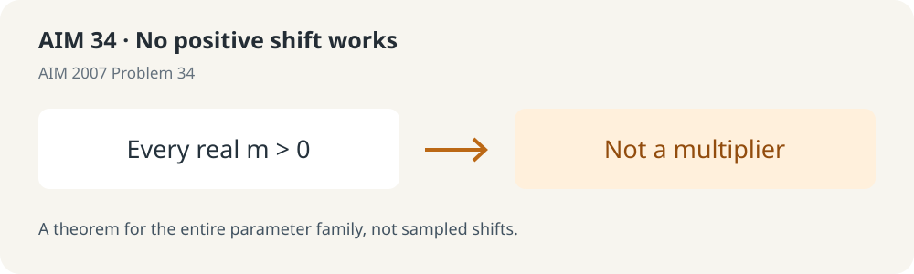

# No positive shift works: AIM 2007 Problem 34

**Every positive real shift fails, not just finitely many test cases.**

AIM Problem 34 asks whether sufficiently large integer shifts turn the sequence n^(√n) into a multiplier sequence. The result here is stronger: **for every real m>0, the sequence (n+m)^(√(n+m)), n≥0, fails to preserve real-rootedness under coefficientwise multiplication.**

## What the proof establishes

For each m>0 there exists a finite real polynomial whose roots are all real but whose transformed polynomial has a nonreal root. The theorem covers both indexing conventions in the source. It does not supply an explicit witness for each parameter or a uniform bound on the witness degree.

[FullAIM34.lean](source/FullAIM34.lean) contains the literal negative-preserver theorem, the finite-polynomial existence theorem and the positive-integer / one-indexed corollaries. The proof constructs its interpolation and analytic uniqueness arguments rather than assuming them.

## Evidence and reproduction

- [Proof outline](source/PROOF_OUTLINE.md) · [earlier ordinary proof](source/provenance/EARLIER_ORDINARY_PROOF.md).
- [Independent review](source/independent_review/INDEPENDENT_REVIEW.md) records fresh compilation of 22 frozen source modules and two independent audit modules, plus expanded semantic guards and a complete logical-dependency audit.
- [Pinned versions](source/PINS.json) · [replay script](source/verify_frozen.sh) · [trust boundaries](source/TRUST_AND_AUDIT.md). Supply Lean 4.19.0 and the pinned mathlib/dependency environment before running the offline script.
- Package hashes were rechecked on 3 November 2026. Historical full Lean replay passed; this packaging check did not rerun Lean.

## Status and limits

AI-assisted public research draft, not human peer review, journal acceptance or a global-priority claim. Some related historical literature was not fully available during the bounded comparison. All retained failed author attempts are historical evidence, not accepted imports.

Original sources: [AIM 2007 Problem 34](https://aimath.org/WWN/polyaschurlax/polyaschurlax.pdf) and [Chasse's dissertation, Problem 58](https://math.hawaii.edu/home/talks/thesis.pdf). The square root occurs in the exponent.

[License and attribution status](LICENSE_STATUS.md)

## This publication snapshot

The [original README](README.original.md) is preserved unchanged. The [source distribution](source/) losslessly compresses one large audit log; all other original source-package files retain their bytes. [Restore the log first](COMPRESSION.md) before running original integrity checks in the restored source tree; the separate [publication manifest](PUBLICATION_MANIFEST.json) binds this outer presentation. See [publication scope and evidence mapping](PUBLICATION.md).

**Historical link notice:** the original AIM problem-list PDF URL returned HTTP 404 during the 3 November 2026 check. Its wording and file hashes are preserved in the historical source audits; this packaging pass did not newly inspect the original AIM pages. The linked Craven–Csordas manuscript (AIM23) and Chasse dissertation (AIM34) were independently retrievable and checked.

**Large-log distribution:** one 28.57 MB public audit log is stored as gzip without dropping any log data. [Compression mapping and restoration](COMPRESSION.md) retain both hashes and verify the decompressed bytes. This source directory is not a byte-for-byte copy of the original tree until restored.
